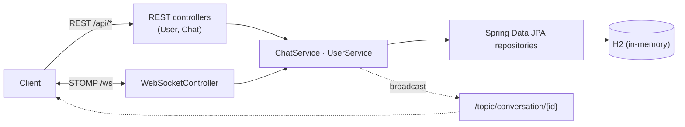

<div align="center">

# 💬 Real-Time Chat Service

**One-to-one direct messaging over REST and STOMP WebSockets, with stable cursor-based history pagination**


</div>

A backend REST API and WebSocket application for one-to-one direct messaging. It started as a take-home exercise, so the design favours a self-contained, zero-config setup with the trade-offs written down (see [Design decisions](#-design-decisions) and [`write-up.md`](write-up.md)).

## ✨ Features

- **User management**: create and list users
- **Conversations**: start a conversation with another user (get-or-create) and list a user's conversations
- **Messaging over REST or WebSocket**: send via the REST API or STOMP, with real-time delivery to subscribers
- **Stable cursor-based pagination**: message history never skips or duplicates messages, even while new ones arrive
- **Authorisation**: users can only read and write messages in conversations they take part in
- **Consistent errors**: custom exceptions (`BadRequest`, `Forbidden`, `ResourceNotFound`) mapped by a global exception handler

## 🏗️ Architecture



Both transports share one service layer, so REST and WebSocket sends go through the same validation and authorisation rules.

```
com.nitesh.chatservice
├── config/        # WebSocket (STOMP) and web configuration
├── controller/    # REST + WebSocket controllers
├── service/       # Business logic and authorisation checks
├── repository/    # Spring Data JPA repositories
├── entity/        # User, Conversation, ChatMessage (+ status/type enums)
├── dto/           # Request / response / WebSocket payloads
└── exception/     # Custom exceptions + global handler
```

## 🧠 Design decisions

| Decision | Why | Production alternative |
|---|---|---|
| **Cursor pagination on message `id`** (descending) instead of offset pages | With offset paging, a new message shifts every page and causes skipped or repeated items. An auto-increment ID gives strict ordering with no ties, unlike a timestamp | Composite index on `(conversation_id, id DESC)` |
| **In-memory H2** | Runs instantly with no Docker or DB setup | PostgreSQL, with Testcontainers in tests |
| **`X-User-Id` header** as identity | Keeps focus on messaging and authorisation logic | Spring Security with JWT |

## 🚀 Getting started

**Requirements:** Java 17+ (Maven wrapper included)

```bash
./mvnw spring-boot:run          # Windows: mvnw.cmd spring-boot:run
```

The server starts on `http://localhost:8080`. The H2 console is available at `/h2-console`.

```bash
./mvnw test                     # integration tests
```
The integration tests cover sending messages, cursor-based pagination and authorisation checks.

## 📡 API overview

Identity is passed with an `X-User-Id` header (simplified for this exercise, see [Limitations](#-limitations)).

### Users
| Method | Path | Description |
|---|---|---|
| `POST` | `/api/users` | Create a user |
| `GET` | `/api/users` | List all users |

### Conversations
| Method | Path | Description |
|---|---|---|
| `POST` | `/api/conversations` | Get or create a conversation with a specific user |
| `GET` | `/api/conversations` | List the authenticated user's conversations |

### Messages
| Method | Path | Description |
|---|---|---|
| `POST` | `/api/conversations/{id}/messages` | Send a message |
| `GET` | `/api/conversations/{id}/messages?cursor={messageId}&limit=20` | Fetch history. Pass the last `id` you received as `cursor` to get the next page |

### WebSocket (STOMP)
| Action | Destination |
|---|---|
| Connect | `/ws` |
| Subscribe (receive messages) | `/topic/conversation/{conversationId}` |
| Send | `/app/chat.send` |

## ⚠️ Limitations

- **Identity is not authenticated.** `X-User-Id` can be spoofed; do not expose this as-is.
- **WebSocket subscriptions are not authorised.** Any client can subscribe to a conversation topic. A STOMP `ChannelInterceptor` that checks conversation membership is the fix.
- **Data is lost on restart** (in-memory database).

## 🗺️ Roadmap

- [ ] Spring Security + JWT, and a STOMP `ChannelInterceptor` for subscription checks
- [ ] PostgreSQL + Testcontainers
- [ ] Index on `(conversation_id, id DESC)` for the pagination query
